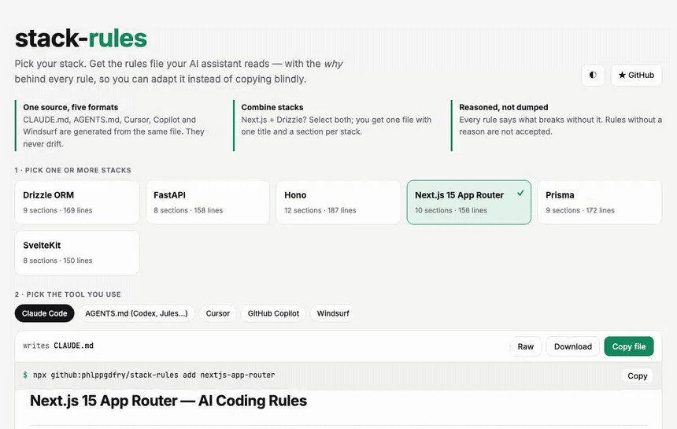

<h1 align="center">stack-rules</h1>

<p align="center">
  <b>Curated AI coding rules per tech stack, with the reasoning behind every rule.</b><br>
  One source file per stack → <code>CLAUDE.md</code>, <code>AGENTS.md</code>, Cursor, Copilot and Windsurf.
</p>

<p align="center">
  <a href="https://phlppgdfry.github.io/stack-rules/"><b>▶ Open the rule picker</b></a> ·
  <a href="#use-it-in-10-seconds">CLI</a> ·
  <a href="#stacks">Stacks</a> ·
  <a href="CONTRIBUTING.md">Contribute</a>
</p>

<p align="center">
  <a href="https://github.com/phlppgdfry/stack-rules/actions/workflows/ci.yml"></a>
  
  
  <a href="LICENSE"></a>
</p>

<p align="center">
  <a href="https://phlppgdfry.github.io/stack-rules/"></a>
</p>

## Why

An AI assistant writes the code its context describes. Without context it writes the average of
its training data: Next.js 13 patterns in a Next.js 15 app, `useEffect` data fetching in Server
Components, Prisma clients created per request.

A good rules file fixes that, but most collections are either links to other repos or bare lists
of "do X, don't do Y". Here every rule says **what breaks without it**, so you can keep, change or
delete it with confidence.

## Use it in 10 seconds

**In the browser:** open the [rule picker](https://phlppgdfry.github.io/stack-rules/), select your
stacks and tool, press **Copy file**. Your selection is in the URL, so you can share it with your team.

**From the terminal** (Node 18+, no install, no dependencies):

```bash
npx github:phlppgdfry/stack-rules list
npx github:phlppgdfry/stack-rules add nextjs-app-router drizzle-orm
npx github:phlppgdfry/stack-rules add fastapi --format agents,cursor
npx github:phlppgdfry/stack-rules add hono --all-formats --dry-run
```

Existing files are never overwritten silently: the CLI asks first (or skips when there is no
terminal to ask in). Use `--force` when you mean it.

| `--format` | Writes | Read by |
| --- | --- | --- |
| `claude` *(default)* | `CLAUDE.md` | Claude Code |
| `agents` | `AGENTS.md` | Codex, Jules, Amp and other `AGENTS.md` readers |
| `cursor` | `.cursor/rules/<stack>.mdc` | Cursor project rules (one file per stack) |
| `copilot` | `.github/copilot-instructions.md` | GitHub Copilot |
| `windsurf` | `.windsurfrules` | Windsurf |

All formats are generated from the same `stacks/<stack>/CLAUDE.md`, so they cannot drift apart.

## Stacks

| Stack | Rules | Highlights |
| --- | --- | --- |
| [Next.js 15 App Router](./stacks/nextjs-app-router/) | 10 sections | Server Components by default, Next 15 caching defaults, Server Actions |
| [SvelteKit](./stacks/sveltekit/) | 8 sections | Svelte 5 runes, load functions, form actions |
| [Hono](./stacks/hono/) | 12 sections | Cloudflare Workers bindings, validators, typed context, RPC client |
| [FastAPI](./stacks/fastapi/) | 8 sections | Pydantic v2, async dependencies, response models |
| [Drizzle ORM](./stacks/drizzle-orm/) | 9 sections | Schema-first types, both query APIs, migrations workflow |
| [Prisma](./stacks/prisma/) | 9 sections | Client singleton, transactions, type inference, migrations |

Planned: Nuxt, Expo, Laravel, Django, Rails, Astro. A stack only appears in this table once its
rules exist — CI checks that the table and the `stacks/` folder match.

## Combining stacks

Select more than one stack and you get a single file: one title, then a section per stack, in the
order you picked them. Headings inside code blocks (Python comments, shell comments) are left alone.

```bash
npx github:phlppgdfry/stack-rules add nextjs-app-router drizzle-orm
# → CLAUDE.md: "Project AI coding rules — Next.js 15 App Router + Drizzle ORM"
```

## Quality checks

```bash
npm test        # CLI behaviour: formats, merging, never overwriting without --force
npm run check   # README ↔ stacks/ in sync, every stack has sections and reasoning
npm run site    # builds the rule picker into _site/
```

## Contributing

Every rule needs a *why*. See [CONTRIBUTING.md](CONTRIBUTING.md): add `stacks/<name>/CLAUDE.md`,
add the stack to the table above, run `npm run check`.

## License

MIT
